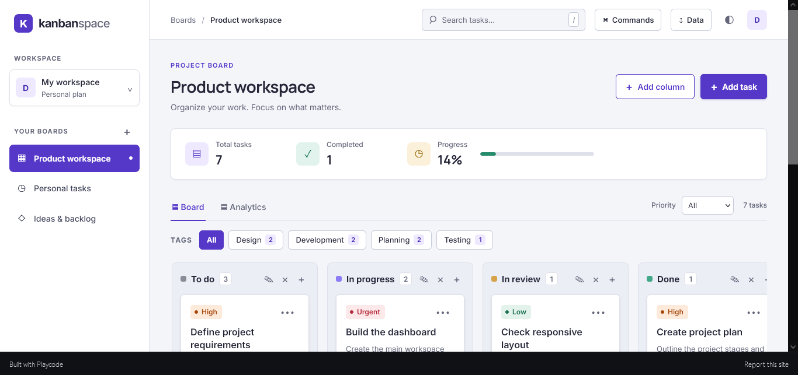
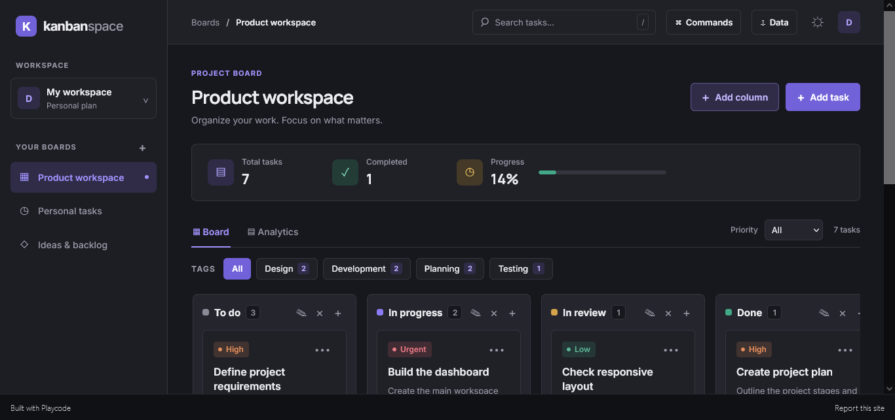
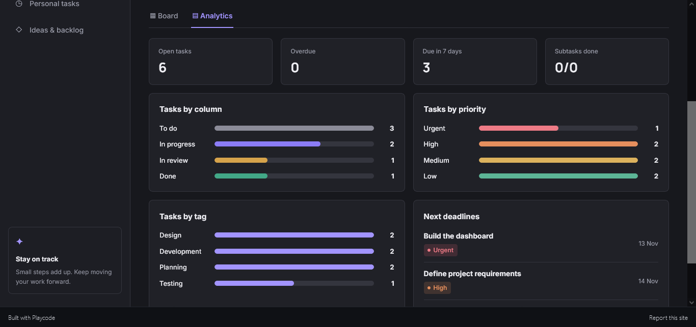
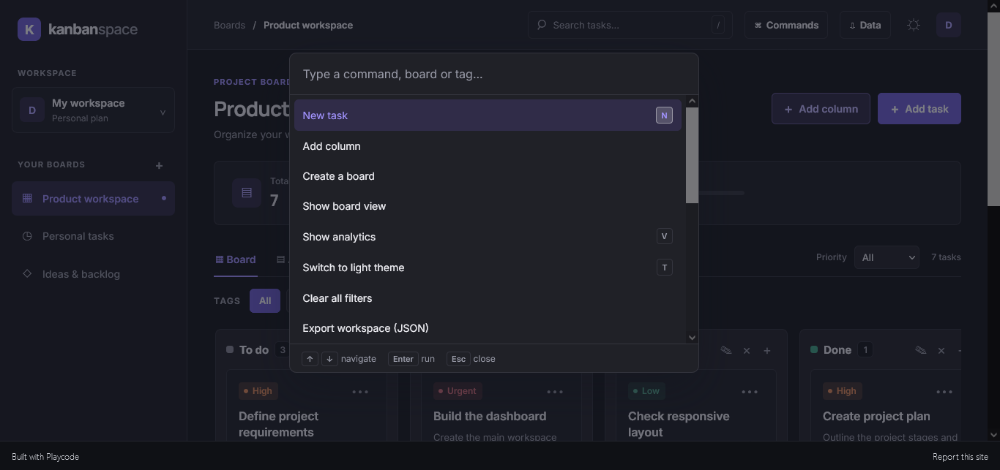

# Kanbanspace






A frontend-only Kanban and task management app built with React. It runs entirely in the browser and saves your data to localStorage.

**Live demo:** https://2791324.playcode.site

## Features

- **Multiple boards** with custom columns (add, rename, delete)
- **Drag and drop** to move cards between columns and reorder within a column, with a drop indicator
- **Tasks** with title, description, priority, tag, due date and subtasks
- **Search**, **priority filter** and **tag filter**
- **Command palette** (Ctrl/Cmd + K)
- **Keyboard shortcuts**: `N` new task, `/` search, `T` theme, `V` analytics, `1-9` switch board, `?` help
- **Analytics view**: open, overdue and due-this-week counts, plus breakdowns by column, priority and tag
- **Overdue highlighting** on due dates
- **Export and import**: JSON workspace backup and restore, CSV task export
- **Light and dark themes**, both designed with a shared token system
- **Responsive layout** with accessible dialogs and keyboard support

## Tech

- React 18.3.1 (hooks only, no state library)
- Plain CSS with custom properties for theming
- No chart or drag-and-drop libraries: charts and drag-and-drop are built from scratch
- Built and deployed with PlayCode

## Project structure

```
src/
  App.jsx      # components, state and logic
  index.jsx    # React entry point
  styles.css   # theme tokens and all styles
package.json
```

## How data is stored

Everything is saved in the browser's localStorage under the key `kanban-workspace-v1`.

Use **Data → Export workspace (JSON)** to back up or move your data. Importing a file replaces the current workspace after a confirmation prompt.

## Running locally

This project was built in [PlayCode](https://playcode.io/react). To run it elsewhere, create a React 18 project (for example with Vite), copy the files in `src/` into it and start the dev server.

## Possible next steps

- Split `App.jsx` into smaller components and use `useReducer`
- Touch-friendly drag and drop
- Cloud sync

## License

MIT
